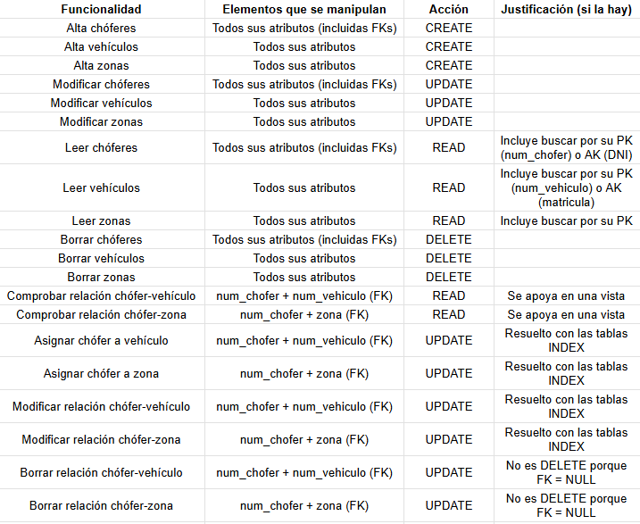
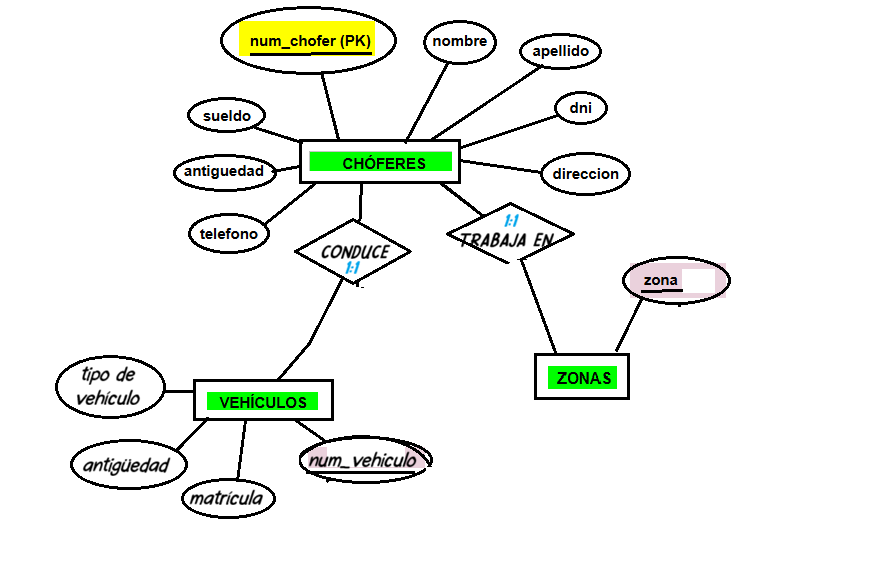
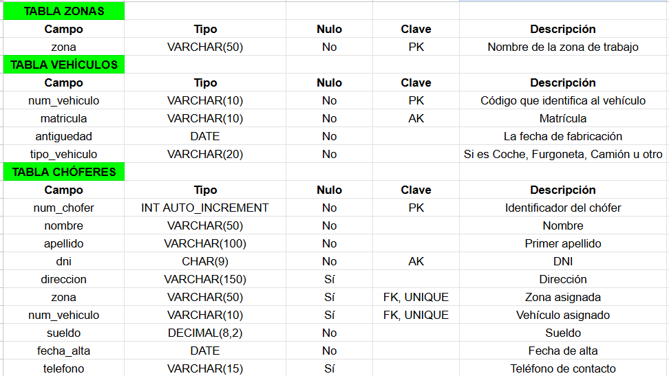
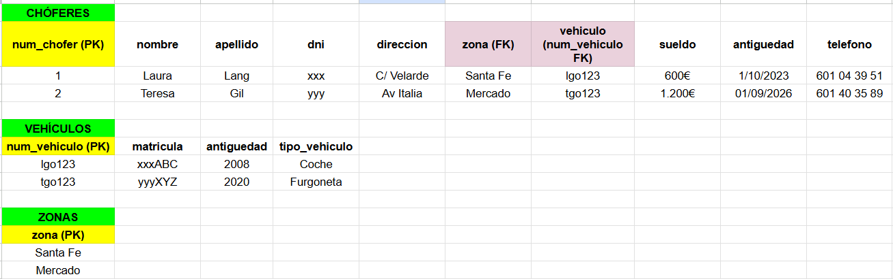

# IFCD0112 MF0226 SQL RDB 4 Data Modeling
Caso práctico de BBDD para una empresa de transportes: de los requisitos de usuario al esquema E-R y lógico, con diccionario de datos, normalización y propuesta de vistas e índices.

## Enunciado:
En una empresa de transporte, con varios conductores, necesitamos tener almacenados en la base de datos la siguiente información:

- Datos de los chofer
- Datos laborales
- Datos del vehículo

Teniendo en cuenta que solo un chófer puede trabajar en una zona por vez y solo con un tipo de vehículo asignado, a partir de los requisitos de usuario:

- Pregunta 1. Señala las funcionalidades que se deben desarrollar en función de lo solicitado por el usuario.
- Pregunta 2. Desarrolla el esquema E-R y lógico con los datos requeridos.
- Pregunta 3. ¿Qué elementos de la base de datos será necesario manipular? Reconócelos en el esquema de la base de datos.
- Pregunta 4. Señala datos del diccionario que serán necesarios para el estudio de la BD.
- Pregunta 5. Determina las tablas (con sus atributos), claves y relaciones.
- Pregunta 6. ¿Crees que serán necesarios incluir nuevos elementos en la BD en función de lo requerido por el usuario? Indícalos y recopila información sobre los mismos
- Pregunta 7. Crea el diccionario de datos.
- Pregunta 8. Reconocer el grado de normalización de las tablas de la base de datos.

Justificar las posibles desnormalizaciones del modelo

- Identificar las funcionalidades a desarrollar a partir de los requisitos de usuario.
- Identificar los elementos de la BBDD a manipular para cada funcionalidad y localizarlos en el esquema conceptual.
- Utilizar el diccionario de datos para observar las particularidades de los elementos de la BBDD a manipular.
- Documentar los elementos de la BBDD que van a ser utilizados para cada funcionalidad para facilitar el seguimiento de los requisitos de usuario.
- Identificar las necesidades de definición de nuevos elementos en la BBDD: tablas auxiliares, vistas, índices.
- Documentar los nuevos elementos de la BBDD para su posterior creación.

Objetivos:
- Determinar los elementos de la base de datos que se han de manipular, mediante la interpretación del diseño de la base de datos y el análisis de los requisitos de usuario.
- En un supuesto práctico de estudio del diseño de la BBDD y de los requisitos de usuario.

## Desarrollo:
### Preguntas 1 y 3: Funcionalidades:


### Pregunta 2: Modelo E-R


### Pregunta 4: Elementos:
Para estudiar la BD, de cada elemento se necesita saber:

- Nombre de la tabla y del campo.
- Tipo de dato y longitud (INT, VARCHAR(50), DATE...).
- Si admite nulos (NULL / NOT NULL).
- Tipo de clave: PK, FK, AK (UNIQUE).
- Tabla y campo referenciados, en el caso de las FK.
- Restricciones de dominio: valores permitidos, rangos (CHECK).
- Valor por defecto, si lo hay.
- Reglas de borrado y actualización de las FK (ON DELETE / ON UPDATE).
- Descripción del significado del campo.

### Pregunta 5: Tablas:
[Ver código SQL](tablas5.sql)

### Pregunta 6: Índices y Vistas:
Mi respuesta es sí, es necesario crear índices y vistas:

#### ÍNDICES:
Hice UNIQUE a zona y num_vehiculo en chóferes, esto hace que no se repitan valores en una columna, es decir, no se podría repetir la zona en chóferes ni el num_vehiculo solo puede haber un vehículo y una zona asignada, tal y como dice el enunaciado: "Teniendo en cuenta que solo un chófer puede trabajar en una zona por vez y solo con un tipo de vehículo asignado":
```sql
CREATE UNIQUE INDEX uq_chofer_zona ON choferes(zona);
CREATE UNIQUE INDEX uq_chofer_vehiculo ON choferes(num_vehiculo);
```

#### VISTAS:
[Ver código SQL](vistas.sql)

### Pregunta 7: Diccionario de datos:


### Pregunta 8: Normalización:
- 1FN. Las tres tablas tienen PK, no hay grupos repetidos y cada celda tiene un único valor. Cumplen 1FN. Matiz: direccion agrupa calle, número y localidad en un solo campo, y apellido puede contener dos apellidos. Se aceptan como atómicos porque nunca se va a buscar ni filtrar por sus partes.
- 2FN. Todas las PK son simples (de un solo campo), así que no puede haber dependencias parciales. Cumplen 2FN.
- 3FN. Ningún atributo depende de otro atributo no clave. En CHÓFERES todo depende solo de num_chofer y en VEHÍCULOS solo de num_vehiculo; no hay dependencias entre atributos no clave.

#### Extra:
Esta imagen son las tablas de manera visual con ejemplos de datos llenos. La hice para ver si podían haber problemas de dependencia funcional y cumplir con la teoría de la normalización y ya que está pues lo adjunto para facilitar la corrección.


## Feedback del profesor:
Estimado/a LAURA GIL ORTIZ,

Te informamos que tienes nuevas calificaciones disponibles referentes a UF2175_UD 5#Actividad 1_Ejercicio teórico-práctico correspondiente al grupo ED24-ED1-MF0226 - PROGRAMACIÓN DE BASES DE DATOS RELACIONALES (IFCD0112).

Dicha tarea ha sido evaluada con una nota de: 9

Mensaje: Buen trabajo: defines con claridad el concepto de metadatos, la estructura está bien desglosada y se agradece que aportes contexto real conectándolo con tu experiencia laboral; como apunte, ten presente que para manipular la estructura del propio diccionario de datos se utiliza casi en exclusiva DDL/DCL, ya que DML se reservaría para los datos de negocio.

Para cualquier consulta que se te plantee puedes contactar con el departamento académico a través de cualquiera de las vías que tienes a tu disposición.

Recibe un cordial saludo (TUTOR) MARIANO HOMERO GIRALDEZ RUBISTEIN .
